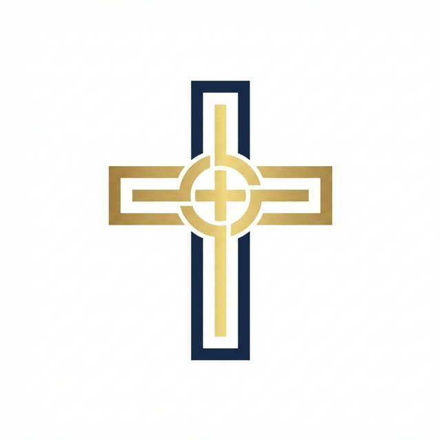

<div align="center">



# 🕊️ برنامج مدارس الأحد
### Sunday School Management System

**النظام البرمجي المتكامل لإدارة مدارس الأحد — Flutter (Android + Windows) + Website PWA**

[](https://flutter.dev)
[](https://dart.dev)
[](https://sqlite.org)
[](LICENSE)
[](https://github.com/UuWagdy/Sunday_School)

---

🌐 **[الموقع التعريفي الرسمي](https://uuwagdy.github.io/Sunday_School/)** | 📱 **[تنزيل للأندرويد](https://www.mediafire.com/file/lf0bdhghulqw15l/SundaySchool_Android.apk/file)** | 💻 **[تنزيل للكمبيوتر](https://www.mediafire.com/file/bsctqpb9gr0gqwy/SundaySchool_Setup.exe/file)**

</div>

---

## 📖 نبذة عن المشروع

**برنامج مدارس الأحد** هو نظام برمجي متكامل مصمم خصيصاً لخدمة الكنيسة القبطية الأرثوذكسية، يهدف إلى تسهيل إدارة مدارس الأحد بكل تفاصيلها من تسجيل الحضور والغياب، نقاط الطايو، تصميم الكارنيهات، الافتقاد، وإدارة الصندوق المالي.

---

## ✨ المميزات الرئيسية

| الميزة | الوصف |
|--------|--------|
| 📅 **الحضور والغياب** | تسجيل رقمي فوري بالـ QR مع دعم وضع الانصراف والفترة |
| 🪪 **مصمم الكارنيهات** | تحكم كامل في التصميم، الباركود، QR، والخلفيات |
| 🎟️ **نظام الطايو** | نقاط وكوبونات جوائز تشجيعية للمخدومين المتميزين |
| 📊 **السلوك والتقييم** | آلية حماية ذكية تمنع تصفير درجات الغائبين |
| 🏠 **الافتقاد والمتابعة** | تتبع الزيارات وتوزيع مهام الافتقاد الجغرافي |
| 💰 **الصندوق المالي** | إدارة الاشتراكات والمصروفات والتقارير المالية |
| 🎵 **الخوارس** | إدارة فصول الألحان والتسبحة وحضور الحفظ |
| 👥 **الرهوط** | مجموعات تنافسية صغيرة داخل الفصل |
| 📄 **التقارير والتحليلات** | تصدير PDF وExcel مع طباعة مجمعة لكل الفصول |
| 🔒 **إدارة المستخدمين** | صلاحيات متعددة المستويات وحسابات منفصلة لكل خادم |
| 💾 **النسخ الاحتياطي** | استرجاع البيانات بنقرة واحدة والترقية السنوية التلقائية |
| 🔗 **صلات القرابة** | ربط أفراد الأسرة وآباء الاعتراف |
| 🔄 **المزامنة اللحظية بين الأجهزة** | ربط أجهزة الكمبيوتر وهواتف الأندرويد في نفس الوقت ومزامنة الحضور والبيانات فوراً عبر SignalR |

---

## 📦 التحميل والتثبيت

### 📱 نسخة الأندرويد (Android APK)
```
https://www.mediafire.com/file/lf0bdhghulqw15l/SundaySchool_Android.apk/file
```

### 💻 نسخة الكمبيوتر (Windows Setup)
```
https://www.mediafire.com/file/bsctqpb9gr0gqwy/SundaySchool_Setup.exe/file
```

> 💡 **تثبيت ذكي ومباشر:** تأتي نسخة الكمبيوتر الجديدة بمثبت موحد وشامل (`SundaySchool_Setup.exe`) يثبت البرنامج وقاعدة البيانات وخادم المزامنة (.NET 8 + PostgreSQL) تلقائياً بنقرة واحدة دون الحاجة لأي ملفات مساعدة خارجية.

---

## 🔄 دليل ربط الأجهزة والمزامنة الفورية (Multi-Device Sync Guide)

يتيح النظام ربط عدة هواتف وأجهزة كمبيوتر للعمل معاً على نفس قاعدة البيانات لحظياً عبر تقنية SignalR:

1. **إعداد كمبيوتر السيرفر الرئيسي:**
   - ثبّت البرنامج وشغّله على الكمبيوتر الرئيسي في الكنيسة باستخدام `SundaySchool_Setup.exe`.
   - يعمل خادم المزامنة (.NET 8 + PostgreSQL) تلقائياً في الخلفية على المنفذ `5050`.
   - افتح زر **"إعدادات الاتصال والسيرفر"** 🌐 بأعلى شاشة تسجيل الدخول لمعرفة عنوان الـ IP المحلي للجهاز (مثال: `http://192.168.1.100:5050`).
   - وافق على تنبيه جدار حماية ويندوز (Windows Firewall) للسماح بالاتصال عبر الشبكة المحلية (Private Networks).

2. **توصيل الهواتف والأجهزة الفرعية:**
   - تأكد من اتصال هاتف الأندرويد أو أجهزة الكمبيوتر الأخرى بنفس شبكة الواي فاي (Wi-Fi) أو الراوتر الخاص بالكنيسة.
   - افتح تطبيق مدارس الأحد على الموبايل، واضغط على زر **"إعدادات الاتصال والسيرفر"** 🌐 بأعلى شاشة الدخول.
   - اختر وضع **"سيرفر مركزي (.NET + PostgreSQL)"**.
   - أدخل عنوان السيرفر بالصيغة: `http://[IP-الكمبيوتر]:5050` (مثال: `http://192.168.1.100:5050`).
   - اضغط **"اختبار الاتصال"** للتأكد من ظهور المؤشر الأخضر، ثم اضغط **"حفظ وتوصيل"**.

3. **بدء الخدمة والمزامنة التلقائية:**
   - سجّل الدخول بحسابك كمسؤول أو خادم (افتراضياً: `admin` / `1234`).
   - الآن المزامنة الفورية نشطة بالكامل؛ أي تسجيل حضور أو انصراف بالـ QR على الهاتف، أو رصد نقاط طايو، ينعكس في نفس الثانية على شاشة الكمبيوتر المركزي وباقي الأجهزة!

### 🔑 بيانات الدخول الافتراضية
| اسم المستخدم | كلمة السر |
|:---:|:---:|
| `admin` | `1234` |

---

## 🗂️ هيكل المشروع

```
petros_pols_flutter/
├── lib/
│   ├── screens/          # شاشات التطبيق (17 شاشة)
│   ├── models/           # نماذج البيانات
│   ├── database/         # قاعدة بيانات SQLite
│   ├── services/         # الخدمات البرمجية
│   └── main.dart         # نقطة الدخول
├── assets/               # الأصول (اللوجو، الخطوط، الأيقونات)
├── introduction_website/ # الموقع التعريفي PWA
│   ├── index.html        # الصفحة الرئيسية
│   ├── manifest.json     # إعدادات PWA
│   ├── sw.js             # Service Worker
│   └── public/           # الصور والأيقونات
├── specs/                # مواصفات المشروع
└── README.md
```

---

## 🌐 الموقع التعريفي (PWA)

الموقع التعريفي متاح على:
**[https://uuwagdy.github.io/Sunday_School/](https://uuwagdy.github.io/Sunday_School/)**

يدعم التثبيت كـ Progressive Web App على الهاتف والكمبيوتر.

---

## 👨‍💻 فريق التطوير

<table align="center">
  <tr>
    <td align="center">
      <b>م. جورج منير</b><br>
      مبرمج النسخة الأصلية (C#)
    </td>
    <td align="center">
      <b>د. يوساب وجدي</b><br>
      تطوير Flutter + تصميم الموقع PWA<br>
      📞 01036976446
    </td>
  </tr>
</table>

---

## 📄 الترخيص

هذا المشروع مفتوح المصدر ومتاح تحت رخصة [MIT](LICENSE) — مجاني للاستخدام والتطوير والمشاركة.

---

<div align="center">

صُنع لأجل مجد المسيح وخدمة كنيسته المقدسة ❤️

**[⬆ العودة للأعلى](#)**

</div>
