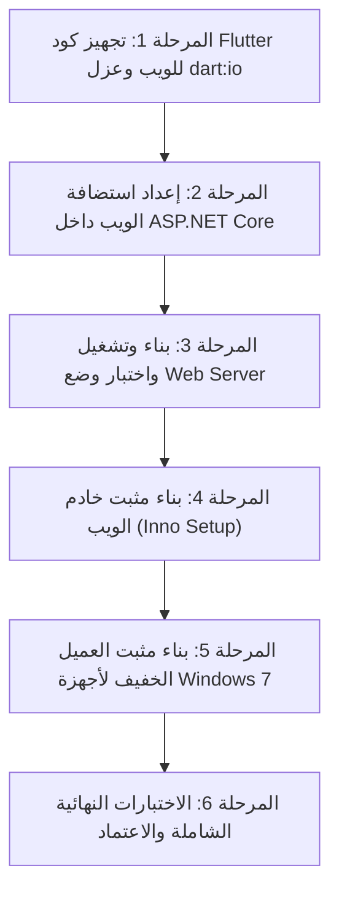

# خطة معمارية شاملة: تشغيل نظام مدارس الأحد في وضع خادم الويب (Web Server Mode) للأجهزة الضعيفة ونظام Windows 7

---

## 1. الملخص التنفيذي والأهداف (Executive Summary)

### المشكلة:
* وجود أجهزة قديمة وضعيفة في الخدمة تعمل بنظام **Windows 7** وغير قادرة على تشغيل تطبيق الويندوز المكتبي (Flutter Desktop) بسبب:
  1. متطلبات محرك Flutter المكتبي الرسمية (Windows 10+ 64-bit).
  2. غياب واجهات برمجة حديثة (DirectX/D3D11, Universal C Runtime) وضعف بطاقات الرسوميات القديمة.
  3. استهلاك موارد الرام والمعالج عند تشغيل تطبيق ديسكتوب محلي وقاعدة بيانات محلية على أجهزة ذات مواصفات متواضعة (2GB / 4GB RAM).

### الحل المقترح (المعتمد):
* **تحويل نمط التشغيل للأجهزة الضعيفة إلى عميل ويب (Thin Web Client)**:
  * يظل جهاز السيرفر الرئيسي (بنظام حديث) مسؤولاً عن تشغيل خادم البيانات `.NET 8 SyncServer` ومحرك `PostgreSQL`.
  * يتم استضافة واجهة التطبيق المبنية بـ **Flutter Web** مباشرة من داخل خادم الـ .NET عبر منفذ Kestrel نفسه (افتراضياً `5050`).
  * تفتح أجهزة Windows 7 التطبيق عبر متصفح الإنترنت (Chrome / Firefox / Edge / Supermium) على عنوان السيرفر المحلي (مثل: `http://192.168.1.100:5050`).
* **توفير خيارين للتثبيت**:
  1. **مثبت خادم الويب (Sunday School Web Server Installer)**: يُثبت على جهاز السيرفر ويشمل الخادم، قاعدة البيانات، وملفات الويب.
  2. **مثبت العميل الخفيف لويندوز 7 (Client App Shortcut Installer)**: مثبت خفيف جداً يوضع على أجهزة ويندوز 7 لإنشاء أيقونة تشغيل مباشرة في وضع التطبيق المستقل (`--app`).

---

## 2. ضمانات عدم تأثر النسخة الحالية (Zero-Regression Guarantee)

| المكون | هل سيتأثر؟ | آلية الضمان |
| :--- | :---: | :--- |
| **نسخة الويندوز المكتبي (Desktop)** | ❌ لن تتأثر إطلاقاً | تظل تُبنى بأمر `flutter build windows` في مسار `build/windows` وتستخدم نفس محرك SQLite والملفات الأصلية. |
| **قواعد البيانات الحالية** | ❌ لن تتأثر | السيرفر يتعامل بالفعل عبر REST API و SignalR؛ لا تعديل في جداول PostgreSQL أو بنية البيانات. |
| **منطق الأعمال (Repositories)** | ❌ لن تتأثر | طبقة `DotNetPostgresQueryExecutor` مصممة مسبقاً وتعمل بنفس الطريقة سواء كان العميل ديسكتوب أو متصفح ويب. |
| **كود الدارت المشترك** | ❌ محمي بالشروط | أي أكواد خاصة بالويب تعزل برمجياً باستخدام `kIsWeb` أو الاستيرادات الشرطية (Conditional Imports). |

---

## 3. تحليل الفجوات التقنية الحالية (Gap Analysis)

### 3.1. استيرادات `dart:io` في تطبيق الفلاتر
يوجد حالياً في المشروع 14 ملفاً تستورد `dart:io` بشكل مباشر (مثل `File`, `Directory`, `Platform`):
* `lib/database/database.dart` (فتح ملف SQLite في الوضع المحلي).
* `lib/screens/attendance_screen.dart` & `buses_screen.dart` & `id_card_screen.dart` & `tayo_screen.dart`.
* `lib/services/bus_pdf_service.dart`, `excel_export_service.dart`, `grouped_pdf_export_service.dart`.
* `lib/services/automatic_backup_service.dart`, `database_backup_service.dart`, `sqlite_backup_snapshot.dart`.

> **الإجراء المطلوب:**
> 1. عزل دوال حفظ الملفات المحلية بحيث تستخدم على الويب التنزيل المباشر من المتصفح (Browser Download عبر `anchor element` أو `bytes` مباشرة).
> 2. استبدال `Platform.isWindows` وما شابهها بفحص `kIsWeb` أولاً.

### 3.2. قيود متصفحات Windows 7 ومحرك رندرة فلاتر
* متصفحات Google Chrome و Microsoft Edge الرسمية توقفت عند إصدار **Chrome 109** على Windows 7.
* محرك **WasmGC** في فلاتر 3.22+ يتطلب **Chrome 119+**، وبالتالي **سيفشل** إذا تم البناء بخيار `--wasm`.
* **الحل:** بناء الويب حصرياً بخيار:
  ```bash
  flutter build web --web-renderer canvaskit --release
  ```
  مع خيار بديل `--web-renderer html` للأجهزة التي تعاني من بطاقات رسوميات قديمة جداً لا تدعم تسريع WebGL.
* **توصية تشغيل:** للأجهزة القديمة جداً، يفضل تثبيت متصفح **Supermium** (متصفح Chromium حديث ومحدث باستمرار خصيصاً لويندوز 7).

---

## 4. مراحل التنفيذ التفصيلية (Implementation Phases)



---

### المرحلة 1: تجهيز كود Flutter للويب وعزل `dart:io`
1. **معالجة حفظ وتصدير الملفات (PDF / Excel)**:
   * إنشاء واجهة تجريدية `platform_file_saver.dart`:
     * على الديسكتوب: تفتح نافذة `Save As` وتكتب على القرص الصلب.
     * على الويب: تنزل الملف مباشرة عبر المتصفح (Blob URL download).
2. **عزل `database.dart`**:
   * التأكد من أن `AppDatabase` عند العمل على الويب لا تحاول استدعاء `_openConnection()` المعتمد على ملفات القرص الصلب، بل تعتمد دائماً على `DotNetPostgresQueryExecutor`.
3. **فحص شروط المنصة**:
   * تعديل الأماكن التي تستخدم `Platform.isWindows` لتكون: `!kIsWeb && Platform.isWindows`.
4. **التحقق من البناء**:
   * تشغيل `flutter build web --web-renderer canvaskit --release` والتأكد من انتهاء البناء بنجاح وبدون أي أخطاء ترجمة.

---

### المرحلة 2: تفعيل استضافة الويب التلقائية في سيرفر الـ .NET
1. **تعديل `SundaySchool.SyncServer/Program.cs`**:
   * تفعيل ملفات الويب الثابتة ودعم التوجيه أحادي الصفحة (SPA Fallback):
     ```csharp
     // تفعيل خدمة الملفات الثابتة من مجلد wwwroot
     app.UseDefaultFiles();
     app.UseStaticFiles(new StaticFileOptions
     {
         OnPrepareResponse = ctx =>
         {
             // كاش للملفات الثابتة ما عدا index.html لضمان التحديث الفوري
             if (ctx.File.Name.Equals("index.html", StringComparison.OrdinalIgnoreCase))
             {
                 ctx.Context.Response.Headers.CacheControl = "no-cache, no-store, must-revalidate";
             }
             else
             {
                 ctx.Context.Response.Headers.CacheControl = "public, max-age=31536000";
             }
         }
     });

     // إعادة توجيه أي مسار واجهة غير معروف إلى index.html لدعم SPA Navigation
     app.MapFallbackToFile("index.html");
     ```
2. **ضبط إعدادات CORS**:
   * بما أن واجهة الويب والـ API سيكونان على نفس السيرفر ونفس المنفذ (5050)، فإن مشاكل الـ CORS تصبح منعدمة تماماً.

---

### المرحلة 3: بناء وإعداد مثبت خادم الويب (Web Server Installer)
1. **إنشاء ملف Inno Setup جديد**: `installer/SundaySchoolWebServerSetup.iss`:
   * المكونات المضمنة في المثبت:
     * قاعدة بيانات `PostgreSQL` المحمولة (Portable).
     * خادم المزامنة `SundaySchool.SyncServer` (منشور بنمط Self-Contained x64).
     * مدير السيرفر `SundaySchoolServerManager`.
     * مجلد ملفات الويب `wwwroot/` (الناتج من `flutter build web`).
2. **إجراءات التثبيت التلقائية**:
   * تسجيل السيرفر كخدمة أو تشغيل تلقائي مع بدء تشغيل الويندوز.
   * ضبط جدار الحماية (Windows Firewall) للسماح بالمنفذ `5050` تلقائياً عبر الشبكة المحلية.
   * إنشاء اختصار على سطح المكتب بعنوان: **"خادم مدارس الأحد (Web & API)"**.
   * إنشاء اختصار لفتح واجهة البرنامج في المتصفح فوراً: `http://localhost:5050`.

---

### المرحلة 4: مثبت العميل الخفيف لأجهزة Windows 7 (Web App Client Installer)
1. **فكرة المثبت**:
   * ملف تثبيت خفيف للغاية (أقل من 2 ميجابايت) يُثبت على أجهزة ويندوز 7 الضعيفة فقط.
2. **الوظيفة**:
   * أثناء التثبيت، يسأل المستخدم عن عنوان IP جهاز السيرفر (أو يكتشفه تلقائياً).
   * يُنشئ أيقونة رسمية على سطح المكتب وقائمة ابدأ باسم **"مدارس الأحد"**.
   * عند الضغط على الأيقونة، تفتح المتصفح في وضع التطبيق النظيف المستقل:
     ```cmd
     chrome.exe --app=http://[IP_السيرفر]:5050/ --window-size=1280,800
     ```
   * يعطي المستخدم تجربة تشغيل طبق الأصل لتطبيق الويندوز المكتبي (بدون شريط تبويب وبدون شريط عنوان) وبسرعة هائلة وخفة تامة.

---

## 5. مصفوفة الاختبارات والتحقق (QA & Verification Matrix)

| الاختبار | الغرض | النتيجة المتوقعة |
| :--- | :--- | :--- |
| **Desktop Build Verification** | التأكد من عدم تأثر نسخة الديسكتوب | نجاح `flutter build windows` وتطابق كامل مع الإصدار السابق. |
| **Web Build Verification** | التأكد من اكتمال بناء ملفات الويب | نجاح `flutter build web --web-renderer canvaskit` وخلوه من أخطاء `dart:io`. |
| **Kestrel SPA Routing** | التأكد من عمل روابط الصفحات والتنقل | فتح أي صفحة مباشرة (مثل `/attendance` أو `/reports`) يعيد `index.html` وتعمل المسارات. |
| **Windows 7 Browser Test** | التحقق من العمل على متصفحات Win 7 | تجربة الفتح على Chrome 109 و Supermium و Firefox 115 بدون كراش للرندرة. |
| **Peripheral Verification** | التحقق من قارئ الباركود والطباعة | قراءة الباركود كـ Keyboard فورية، والطباعة تفتح نافذة PDF للطباعة بنجاح. |
| **Data Mutex & Concurrency** | التأكد من سلامة التسجيل المتزامن | قدرة أكثر من جهاز على تسجيل الحضور والبيانات في نفس الوقت عبر السيرفر. |

---

## 6. خطوات التنفيذ المباشرة المقترحة للبدء

1. **الخطوة الأولى:** البدء في فحص وتعديل ملفات الخدمات الـ 14 لإزالة أي تعارض مع الويب وعزل `dart:io`.
2. **الخطوة الثانية:** تجميع الويب وتضمينه داخل سيرفر `SundaySchool.SyncServer`.
3. **الخطوة الثالثة:** إعداد سكربتات Inno Setup لمثبت خادم الويب ومثبت العميل.
